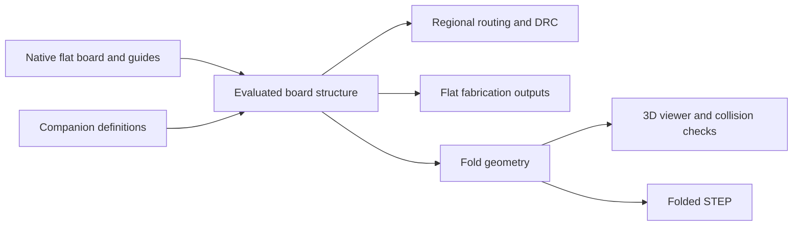

# Flex and rigid-flex support for Backplane KiCad

Master-port status (2026-10-14): source port only, based on `fe761fb867`
(KiCad 10.99) and WIP snapshot `1747f64599`. No C++ compilation, native GUI,
DRC, routing, viewer, or STEP runtime checks were performed for this port.
Historical builds below refer to the 10.0.6 fork. The lead must validate on the
separate build host before treating this as a working runtime.

Status: design specification with implementation and local validation in progress; acceptance criteria below are not a claim of complete feature parity. Research date: 2026-09-11. Source baseline inspected: `1c193606eddedbf98f8c9af5100b5e8f79da603d`. Current base: upstream master `fe761fb867` (KiCad 10.99), with source ported from snapshot `1747f64599`. Native files use upstream tokens only; fork extensions remain in companions.

The recommendation is a shared, region-aware physical board model used by the editor, router, DRC, 3D viewer, and manufacturing exporters. Add explicit stiffeners and bend definitions to that model. Keep all electrical artwork in the flat board coordinate system and persist physical definitions in a versioned Backplane model. The current implementation uses `.kicad_pcb.backplane.json`; v1 companions migrate to v2 on the next save while item metadata moves to master native fields.

## What Altium does

These findings come from Altium documentation and demonstrations, not an interactive test of an installed Altium release. UI details and output behavior should be checked against a specific installed version before claiming exact feature parity.

| Area | Documented behavior | Implication for KiCad |
|---|---|---|
| Board regions | Standard mode splits a board using split lines. Advanced mode uses independently editable polygonal regions, each assigned a substack. Regions can be sliced or created from drawing primitives. | Use polygonal regions as the underlying model; slicing is an editing operation. |
| Stackups | Advanced mode defines substacks, shared layers, individual materials, alignment, and branches. | Copper identity and material identity must survive across region boundaries. |
| Stiffeners | A demonstrated workflow adds stiffener/adhesive layers to a substack and assigns that stack to the intended region. | Position follows designer-defined geometry and stack assignment. |
| Bends | Designer supplies line, affected region(s), angle, radius, and fold order. | Store intent explicitly and derive bend geometry. |
| Coverlay | Separate polygonal coverage and cutouts; automatic pad openings; distinct fabrication output from solder mask. | Coverlay needs physical and manufacturing semantics beyond a colored drawing. |

Altium's advanced region tools label regions with their stack assignment and provide a fixed 3D reference region. Its overlap/priority rules affect region display and interpretation; overlapping drawings alone do not specify the physical stack intrusion. [Altium region planning](https://www.altium.com/documentation/altium-designer/pcb/rigid-flex-design/advanced/planning-regions).

In the stack manager, copying selected layers into another substack shares their identity; edits propagate to shared layers. Individual material usage permits different adjacent materials. Sections and branches support multiple flex stacks and bookbinder arrangements. [Altium substack definition](https://www.altium.com/documentation/altium-designer/pcb/rigid-flex-design/advanced/defining-substacks).

### Does Altium decide where stiffeners go?

The reviewed sources do **not** establish automatic stiffener placement or structural optimization. Altium's demonstration explicitly adds a stiffener to a stack and assigns that stack to a board region. Treat this as designer-authored mechanical intent. [Altium Designer 21 demonstration](https://resources.altium.com/webinars/altium-designer-21).

A stiffener provides local mechanical support without adding routed copper layers. Integrated rigid-flex adds rigid laminate and potentially additional electrical layers. Those are different constructions even when both look like a rigid island in 3D. [Altium construction comparison](https://resources.altium.com/p/layer-stackup-rigid-and-rigid-flex-pcbs).

Practical stiffener placement follows connector and assembly requirements: support beneath component areas, reinforcement at handled features, and controlled thickness at connector fingers. All Flex describes FR4 support regions and polyimide/polyester thickness reinforcement, including adhesive choices and registration allowances. Its guide recommends 0.030 inch coverlay/stiffener overlap to avoid coincident termination stress points; this is a supplier guideline, not a universal default. [All Flex design guide, stiffener section](https://www.allflexinc.com/wp-content/uploads/2023/04/AFS-AllFlex-Circuit-Design-Guide.pdf).

For a ZIF tail, the connector's mating-thickness requirement is an input. The stack, adhesive, and stiffener must satisfy that requirement together; the connector cannot be identified reliably from pad geometry alone. [All Flex ZIF considerations](https://www.allflexinc.com/blog/designing-with-a-zif-connector/).

### How bends are displayed

Altium places bend lines in Board Planning Mode. A highlighted strip shows the affected area; its width follows radius and angle. In advanced mode, the line can apply to selected underlying stack regions, and its extent is fitted to the region. Signed angles control bend direction, fold indices control order, and a locked region anchors the folded assembly. [Altium bend definitions](https://www.altium.com/documentation/altium-designer/pcb/rigid-flex-design/advanced/defining-bending-lines).

The documented relation is `w = radius * abs(angle_in_radians)`, using Altium's surface-radius convention. A 3D fold-state control shows the flat, intermediate, and fully folded board. This supports mechanical inspection; the reviewed documentation does not establish a fatigue-life or stress solver. [Altium rigid-flex overview](https://www.altium.com/documentation/altium-designer/pcb/rigid-flex-design).

### Coverlay, rules, and deliverables

Altium can generate coverlay coverage for a region and pad openings from mask expansion rules, with manual polygon/cutout editing. It outputs coverlay separately from solder mask. Its documentation also notes that moving a region does not automatically move its coverlay polygon in the described workflow—an association problem our model should avoid. [Altium coverlay](https://www.altium.com/documentation/altium-designer/pcb/rigid-flex-design/including-coverlay-flex-region).

Region-scoped rules are available through `InLayerStackRegion`, whose documented test uses an object's reference point. Via-type availability still depends on routing rules; defining a via in a substack does not itself restrict routing to that region. [Altium membership queries](https://www.altium.com/documentation/altium-designer/pcb/query-functions/membership-checks), [Altium layer stack and via rules](https://www.altium.com/documentation/altium-designer/pcb/defining-layer-stack).

Documented ODB++ 8.1 output includes rigid/flex/bend/stiffener layer subtypes, region outlines and layer membership, and stiffener profile/thickness. This shows why manufacturing parity requires more than folded STEP. [Altium fabrication output](https://www.altium.com/documentation/altium-designer/preparing-fabrication-data?version=21).


## Multi-body and multi-board behavior

There are two different authoring levels: physical bodies associated with one PCB,
and an assembly containing independent boards and mechanical parts.

Altium's multi-board workflow transfers a logical system schematic (`.MbsDoc`)
into a physical assembly (`.MbaDoc`). The assembly can reference PCBs, nested
assemblies, and STEP parts. An inserted STEP file is one manipulable part; separate
enclosure halves need separate imports to move independently. Parts can be locked,
updated from their sources, positioned, and joined with mates. Assembly collision
checking includes surface contact and intersections, including hidden parts.
The documented editor supports rigid-flex boards. These are documented capabilities,
not a local Altium runtime test.
[Altium physical assembly documentation](https://www.altium.com/documentation/altium-designer/multi-board-design/physical-assembly).

System-level electrical connections and the physical arrangement are related but
separate data. Importing mechanical solids alone does not establish connector pin
connectivity. A comparable KiCad implementation needs source-board references,
instance transforms, explicit connector mappings, and a mechanical assembly view.
[Altium multi-board overview](https://www.altium.com/documentation/altium-designer/multi-board-design).

For this fork, use a separate `.backplane-assembly.json` manifest so several native
boards remain independent board documents. Resolve paths relative to
the manifest, reload source geometry during export/check, and keep source PCB
coordinates unchanged. Store instance identity, kind, translation in millimetres,
rotation in degrees, the anchored instance, point/axis constraints, and connector
mappings. Export combined STEP and use OCC geometry for interference checks.
Missing sources and failed geometry operations must fail the check explicitly.

Assembly manifests and their GUI/IPC implementation are owned by a separate
port. This document's master implementation claims cover one board's physical
structure only; the preceding assembly discussion is design context.

## Product scope and workflow

The implemented canvas entry point is **Appearance → Layers → Rigid-flex tools…**.
See [the canvas workflow](BACKPLANE_STRUCTURE_CANVAS.md) for drawing, editing,
Undo/Redo, and the remaining interaction limitations.

Initial scope: flex-only boards with local reinforcement and simple rigid islands connected by non-overlapping flex regions. Support multiple sequential cylindrical bends and planar branches with an unambiguous rooted fold tree. Defer overlapping flex leaves, bookbinder stacks, arbitrary twist, compound curvature, closed mechanical loops, and automatic structural optimization.

1. In Board Setup, define the global electrical layers and material stacks. Mark each regional stack as rigid or flex; enter physical material thicknesses and tolerances.
2. In a new Board Structure workspace, partition the existing outline into labeled regions. Assign a stack to each. Keep ordinary placement/routing available with structure overlays.
3. Draw stiffeners or create a suggestion from selected components or an explicitly defined connector tail. Set material, attachment side, adhesive, thickness, and outline.
4. Define coverlay coverage/openings and bend lines. Choose an anchor island or flat reference patch for flex-only boards.
5. Route with local layer availability and flex constraints. Review transitions, unsupported components, bend-zone violations, and construction gaps.
6. Open 3D with Flat, Folded, and Assembly Sequence states, a scrubber, and per-bend controls. Selecting a violation selects its 2D source.
7. Run electrical and mechanical checks; generate flat fabrication data, construction drawings, and a separately labeled folded mechanical model.

Use distinct fill patterns plus labels for rigid, flex, and stiffener regions, so color is not the only cue. Show bend axis, tangent boundaries, direction arrow, radius convention, angle, and fold order. Display local stack/thickness under the cursor. The stack editor includes a cross-section view with shared copper highlighted.

## Data model

Proposed in-memory `BOARD_STRUCTURE` belongs to `BOARD`; all consumers use one immutable evaluated snapshot per board revision. New types and interfaces below are proposed, not existing APIs.

| Entity | Required information |
|---|---|
| Material | Stable ID, category, material reference, nominal/min/max thickness, optional dielectric/mechanical properties, supplier/source revision |
| Regional stack | Ordered material/layer instances, rigid/flex classification, global copper layer mapping, shared continuity IDs, Z datum, exposed surfaces, allowed drill spans |
| Region | UUID, name, polygon with holes/arcs, stack ID, attachment boundaries, authoritative geometry references |
| Stiffener | UUID, parent region, outline/cutouts, top/bottom physical attachment, material and adhesive, thickness tolerances, mechanical role, support targets, optional electrical bonding intent |
| Coverlay | UUID, parent region, side/surface, material/adhesive, coverage outline, opening geometry/rules, explicit polarity and registration tolerance |
| Bend | UUID, region ID, directed axis, affected strip, signed target angle, inner radius, neutral-axis convention, moving side, sequence interval, use class |
| Fold configuration | UUID/name, anchor patch, bend angles/sequence, intended use, named assembly state |
| Rule profile | Fabricator/source revision, constraint values, severity, scope, waivers with reasons |

Use integer board units for planar geometry and explicitly named units for serialized physical quantities. Preserve arcs, UUIDs, unknown extension fields, and schema versions. Do not serialize cached meshes or transformed electrical artwork as authoritative data.

A stiffener is a local material addition, not an extra copper layer or another electrical board region. Evaluate it into the local physical stack for thickness and clearance. Avoid creating a separate user-visible stack for every reinforcement patch. Metallic stiffeners need insulation/bonding declarations; do not silently connect them to a net.

At a point, the evaluator returns stack identity, present copper layers, local Z intervals, exposed surfaces, coverlay, and reinforcement. Along a trace or across a polygon it returns all intersected regions. A center-point-only test is insufficient for a track crossing a boundary or a component spanning a bend.

Initial region rules: exactly one base region at each point within the board outline; no base-region overlap or unexplained gaps. Stiffeners and coverlay overlay that partition. Adjacent regions must share matching boundaries and consistent copper continuity. Later support for multiple leaves requires explicit branch/leaf identity and physical Z relationships, not drawing priority.

## Native persistence and migration

Native layer IDs, board item types, tokens, and file-version changes are allowed when they improve the construction workflow. Version extensions and test migration from existing Backplane files. Copper, pads, vias, footprints, net identities, and outer/cutout geometry remain native and flat. Internal region divisions must not become `Edge.Cuts`, because they are not routed board edges.

Use dedicated construction layers for boundaries, bends, and sided stiffeners. The current implementation stores their authoritative geometry and physical meaning together in the versioned `board_structure` companion. Native item/layer persistence is permitted; a migration must preserve IDs, stack assignments, undo behavior, and existing projects. Generated labels and fabrication illustrations must remain distinguishable from authoritative geometry.

Existing hooks are `BACKPLANE_DOCUMENT_METADATA::{Load,Save,CaptureExtension,ReadExtension}` in `include/backplane_document_metadata.h` and `common/backplane_document_metadata.cpp`, and `applyMetadata`/`captureMetadata` in `pcbnew/pcb_io/kicad_sexpr/pcb_io_kicad_sexpr.cpp`. These are extension points, not proof that the entire new lifecycle already works.

Required lifecycle behavior:

- Track board/companion generation and native structural fingerprints. On external edits, resolve UUID references against current native geometry and invalidate stale evaluations. Report orphaned or conflicting definitions; never silently apply old geometry.
- Treat native plus companion save as a recoverable pair. Individual atomic replacement is insufficient if the application exits between files; retain a paired recovery generation/journal.
- Cover Save As, autosave/recovery, backups, copy/paste, duplicate, rotate/flip, append board, project copy, CLI staging, archives, and export staging. Copying must remap all IDs; partial copies must report unresolved dependencies.
- Include structure edits in normal undo/redo and dirty-state tracking. Moving a component with a suggested stiffener should mark the support relationship for review; only explicitly attached reinforcement follows automatically.
- Preserve unknown fields on load/save, reject unsupported semantic versions for structure operations, and preserve unreadable/newer companion data without rewriting it.
- Backplane save/reopen and migration must preserve copper, connectivity, physical definitions, and regional validation. Stock KiCad interoperability is optional, not a release gate.

V1 component mounting is restricted to locally exposed global F.Cu/B.Cu surfaces. A rigid-flex substack exposing In1.Cu can carry routed copper, but mounting a component there is outside V1. Supporting inner-layer component mounting later requires an explicit pad/mount-surface model and a versioned native mounting model. Do not fake it with a 3D Z offset.

## Stiffener assistance

Offer **Suggest stiffener** as an explainable drafting aid; do not describe it as mechanical analysis or an Altium feature.

Inputs: selected components/support areas or connector mating outline, required mating thickness interval from its datasheet, assembly/load classification, attachment side, available materials, adhesive tolerances, coverlay geometry, bend exclusions, and fabricator constraints.

Algorithm:

1. Construct a support envelope from the declared mechanical support geometry. A courtyard can seed the outline but does not prove adequate support under load.
2. Expand by the chosen supplier margin, combine compatible adjacent patches, and round corners to the supplier's process limits.
3. Check against bend strips plus transition clearance, board edges, holes, component access, coverlay terminations, and assembly keepouts. Return conflicts when no feasible outline exists; do not silently trim away required support.
4. For a connector tail, evaluate thickness at the actual contact/insertion cross-section. Include only materials physically present there, including finish and compressed adhesive where specified.
5. Choose from available reinforcement thicknesses whose **full tolerance interval** fits the connector requirement. If none fit, report the mismatch. Do not assume adhesive compression or a standard connector thickness.
6. Show the proposed outline, stack cross-section, supporting inputs, and remaining unknowns for designer acceptance.

Example arithmetic, deliberately hypothetical: if existing tail thickness is 0.14–0.16 mm, adhesive is 0.02–0.03 mm, and the connector accepts 0.28–0.32 mm, the stiffener interval must satisfy `t_min >= 0.12 mm` and `t_max <= 0.13 mm`. A nominal-only match does not suffice. Actual material tolerances and local copper/coverlay construction must replace these example values.

Component mass, insertion force, shock, and repeated bending cannot be reliably inferred from placement. Store them as supplied requirements or leave them explicitly unverified. Rule profiles distinguish assembly-only bends from repeated-flex applications; no universal bend-radius multiplier or stiffener margin is built in.

## Bend geometry and 3D behavior

Use cylindrical, developable bend strips for V1. Define the directed axis and moving side in flat board coordinates; resolve UI clockwise/counterclockwise labels against the displayed face. Convert PCB coordinates to a documented right-handed mechanical frame once.

Store an explicit **inner radius** and neutral-axis location. For a homogeneous visualization approximation with thickness `t`, use `Rn = Rin + t/2`; label this assumption. A user/fabricator neutral-axis offset can replace it for a laminate. The visualization is not a stress or fatigue prediction, and its convention must not be silently equated with Altium's surface-radius parameter.

For target angle `theta`, define fixed flat strip length `L = Rn * abs(theta)` with radians. Reject negative inner radii, degenerate strips, and strip geometry outside permitted flex. Radius and angle edits change the implied tangent boundaries and must preview resulting conflicts.

During animation, retain `L`; at intermediate angle `phi`, use curvature `k = phi/L` and radius `1/abs(k)`. For distance `u` along the neutral surface from the fixed tangent, local displacement is `(sin(k*u)/k, (1-cos(k*u))/k)`, with the straight limit `(u,0)` at zero. Build thickness offsets using the local normal. Keeping the final radius constant while reducing the angle would incorrectly change the bent material length.

Split meshes at tangent lines and regional/material boundaries, bend the strip, and rigidly transform the downstream patch. Evaluate bends through a rooted attachment graph. Sequencing controls animation; it must not substitute for explicit geometric parentage. Reject overlapping bend strips, ambiguous cuts, closed loops, and unsupported twist instead of showing plausible but wrong folds.

Attached components remain rigid and inherit their support patch transform; stiffeners remain rigid too. A body spanning an active strip or multiple moving patches is a conflict. Copper, mask, coverlay, holes, and substrate must follow the same deformation field. Flat pattern and connectivity never change with the scrubber.



Use the same geometry service for interactive viewing and exports. Tessellation must have an explicit chord-error tolerance; normals, picking, bounds, and shadows must use the folded geometry. Cache by board revision, configuration, and tolerance. Define a reference fixture and performance budget before choosing a GPU-only optimization.

Collision checks include board-to-board, component-to-component, component-to-board/stiffener, and optional enclosure models. Exclude only declared bonded/contact interfaces. Use broad-phase bounds followed by mesh/solid distance tests. Report clearance, configuration, bend state, and source objects. Discrete animation samples are not a guarantee of collision-free motion; mark sampled checks as such until continuous/swept checking exists. Missing models must appear in the report.

## Electrical and manufacturing checks

| Check | Required behavior |
|---|---|
| Layer presence | Flag any copper geometry outside the physical extent of its layer; clip zone fill to valid extents before connectivity is evaluated. |
| Stack transition | Preserve continuous copper IDs; check local copper-to-material-edge clearance without treating every region boundary as a copper edge. |
| Vias and holes | Validate full pad/drill footprint, local span, annuli, reinforcement clearance, and permitted fabrication sequence. Reject unsupported stacks/spans. |
| Bend exclusions | Intersect full pad/via/component/stiffener geometry with strips and supplier transition margins. |
| Routing through bends | Configurable checks for crossing direction, sharp corners, neckdowns, conductor stacking, and plane construction; no silent rerouting. |
| Impedance/return path | Evaluate regional stacks separately and flag transition review requirements. Do not claim one global impedance calculation covers the flex. |
| Coverlay | Separate coverage, pad openings, minimum web, registration allowance, exposed-conductor checks, and termination overlap rules. |
| Reinforcement | Verify target support coverage, insertion thickness tolerance, hole registration, attachment side, and bend conflicts. |
| Geometry validity | Detect self-intersections, gaps, overlaps, unresolved references, incompatible shared layers, and impossible fold topology. |

Routing restrictions and zone clipping are necessary for a manufacturing release. A DRC-only prototype may identify invalid copper but is insufficient if zone filling can continually recreate it. Region queries must examine complete geometry and have deterministic boundary tolerances.

Manufacturing output remains flat. Provide copper Gerbers, applicable mask/paste, drilling, explicit coverlay profiles/openings, stiffener and adhesive outlines, regional stack drawings, bend table, material/tolerance schedule, and assembly sequence. Specify polarity, datum, units, material side, and file role in a manifest. Include the native board and companion as design sources; the companion is not a substitute for fabricator-readable drawings.

Audit region and drill semantics separately in Gerber, ODB++, and IPC-2581 exporters; existing format support does not establish rigid-flex support. Unsupported combinations must produce a clear error rather than a success with omitted layers. Keep flat placement data separate from folded mechanical coordinates. Folded STEP must identify its configuration and include reinforcement thickness; verify it in an independent viewer.

## Source integration plan

The inspected implementation has three concrete limitations. `BOARD_STACKUP::SynchronizeWithBoard()` synchronizes one global stack against enabled board layers. `BOARD_ADAPTER` approximates internal copper Z positions by evenly distributing them through the body thickness, as its source comment explicitly states. `EXPORTER_STEP` calls `STEP_PCB_MODEL::CreatePCB()` with the collected board outline, while `getBoardBodyZPlacement()` and `getCopperLayerZPlacement()` use one global construction. A folded viewer patch alone would therefore leave physical stack and exported geometry inconsistent.

DRC integration can use the existing `DRC_TEST_PROVIDER` registration mechanism, but interactive enforcement separately needs `PNS_PCBNEW_RULE_RESOLVER::QueryConstraint()` and routing layer-transition logic. New structure IPC must have its own round-trip implementation: the inspected `BOARD_STACKUP::Deserialize()` is not an existing complete route for importing regional definitions.

| Existing source area | Proposed change |
|---|---|
| `pcbnew/board_stackup_manager/board_stackup.{h,cpp}` and `panel_board_stackup.cpp` | Preserve global stack behavior for ordinary boards; introduce regional stacks and shared-layer identity through a separate structure model. |
| `pcbnew/board_design_settings.cpp`, `pcbnew/board.cpp` | Own/query evaluated regional structure without replacing global electrical layer IDs. |
| `pcbnew/pcb_io/kicad_sexpr/pcb_io_kicad_sexpr.cpp`, `common/backplane_document_metadata.cpp` | Companion schema, guide associations, reconciliation, pair recovery, extension preservation. |
| `pcbnew/tools/`, `pcbnew/pcb_painter.cpp` | Structure editing, selection filters, guides, property panels, undo integration, diagnostic overlays. |
| `pcbnew/drc/`, `pcbnew/router/pns_kicad_iface.cpp`, `pcbnew/zone_filler.cpp` | Local stack queries, boundary-aware constraints, viable layer choices, valid fill extents. |
| `3d-viewer/3d_canvas/board_adapter.{h,cpp}` | Replace a single planar substrate representation with per-region geometry for structure-enabled boards. |
| `pcbnew/exporters/step/exporter_step.cpp`, `pcbnew/exporters/step/step_pcb_model.cpp` | Shared fold transforms and regional solids, flat/folded state options. |
| `pcbnew/api/`, `api/proto/`, CLI job handlers | Versioned structure operations, validation, fold configuration, capability reporting and deterministic export. |
| `qa/tests/pcbnew/`, `qa/tests/cli/`, `scripts/backplane-*.py` | Geometry, persistence, regional electrical behavior, IPC, export, Backplane round-trip and migration regressions. |

Keep the geometry evaluator independent of wx UI and graphics context so CLI, DRC, and tests use the same results. Proposed API operations include reading structure, transactional region/stiffener/bend edits, validating, and evaluating/exporting a named fold state. Return revision IDs and reject stale mutations. Coordinate these capabilities with the sibling Backplane app; companion JSON editing from the app must not bypass board transactions.

## Delivery milestones and acceptance gates

**M0 — persistence and geometry spike.** Build a two-island/one-flex fixture, prototype regional queries and a cylindrical fold, and prove physical-model save/reopen in Backplane. Resolve copper Z alignment and exposed-layer restrictions before committing to the UI design.

**M1 — structure authoring.** Deliver regional stacks, guides, manual stiffeners/coverlay, bend definitions, undo/redo, persistence, and flat construction drawings. Invalid topology produces selectable errors. This is a planning feature until M3 passes.

**M2 — folded visualization.** Deliver constant-length bending, anchored components, named configurations, per-layer rendering, and folded STEP. Verify 0°, positive/negative 90°, and 180° bends, nonparallel sequential axes, and a flex-only reference patch. A pure visualization release must be labeled accordingly.

**M3 — manufacturable simple flex/rigid-flex.** Complete routing, fill, via, DRC, output, and persistence gates. Have a fabricator review a generated package. This is the first release that can claim supported fabrication for its documented construction subset.

**M4 — assistance and advanced mechanics.** Add stiffener suggestions and broader collision checking. Treat bookbinder/multiple-leaf topology and inner-layer component mounting as separate design efforts with their own migration and validation gates.

Required acceptance fixtures:

- Flex-only connector tail with reinforcement and independent coverlay openings; top and bottom stiffeners and thickness-tolerance failure cases.
- Four-layer rigid/two-layer flex/two rigid-island board; shared-layer continuity, absent-layer copper errors, and correct zone clipping. Components remain on supported exposed F.Cu/B.Cu surfaces.
- Multiple sequential bends, a planar branch, opposite bend directions, and a nested cutout whose fold topology is still unambiguous.
- Invalid overlap, orphaned UUID, malformed companion, duplicate IDs, zero radius, overlapping strips, wrong anchor, and unsupported closed-loop topology.
- Pad or via crossing a region boundary with its center outside the problem area; validates full-geometry checks.
- Save As, Backplane open/edit/save/reopen, refill, format migration, recovery after interruption between pair writes, copy/paste, staging, and project archive preservation.
- Viewer and STEP comparison against analytical tangent endpoints and rigid-body transforms at explicit tolerances; independent STEP reopening and visual review.
- Manufacturing package inspection for each supported exporter, including coverlay polarity, local material edges, layer continuity, and stiffener thickness.
- Existing ordinary rigid boards retain equivalent connectivity, DRC results, plots, and 3D/export geometry.

No runtime, manufacturing, or fatigue validation was performed for the initial research document. Later local results are recorded in BACKPLANE_STRUCTURE_VALIDATION.md. These are implementation acceptance requirements, not completed checks.

## KiCad 10 export

Master saves upstream's current native format. Keep `<board>.kicad_pcb.backplane.json`
beside the board, and export a copy outside the source project:

```sh
kicad-cli project downgrade --target 10.0 -o /path/outside/project project.kicad_pro
```

The existing downgrade command copies the companion unchanged beside the exported
board. Stock KiCad 10 sees the native flat electrical board: copper, footprints,
Edge.Cuts and supported drawings. It ignores the companion and has no regional
stack, bend, stiffener, coverlay, construction-layer state or folded view. A stock
save does not update physical structure; review the companion after artwork edits.

Downgrade reports loss or blocked conversions before export. Custom item properties
are removed after dependent displayed text is resolved. Supported graphic endings
are converted to printed polygons and shortened line bodies, losing endpoint
editability. Styled/colored endings can block approximation; the explicit
`--drop-approximations --force` policy removes endpoint embellishments instead.
Other master-only features follow upstream's compatibility report (for example,
constraints, local grids and drill-chart definitions may be dropped). Review that
report before using `--force`. No downgraded native file encodes regional fabrication
or folded mechanics. Flat construction Gerbers and the manufacturing manifest must
be delivered separately; a companion alone is not a fabrication drawing.

## Companion migration on master

On load, v1 `items` custom properties fill missing native property names. Each
legacy line ending is applied only when the corresponding native endpoint has
style NONE. Native names and nonempty endpoints win. Legacy board-root properties move into native `(property ...)` entries because
master has no root-level custom_property token. Native board-property values win.
Legacy footprint simulation flags also move into native flags. The model keeps unknown fork extension fields.
Load does not write either file.

On save, the plugin writes native master tokens and a v2 companion:

```json
{"format":"backplane-kicad-metadata","version":2,
 "extensions":{"root":{"board_structure":{"schema_version":1}}}}
```

The example shows the wrapper only; a real structure includes its full arrays.
No `items` section is written. An empty extension set deletes the companion.
Save As and SaveCopyOfDocument use live document metadata at the destination;
they do not copy stale v1 bytes. The native save and companion replacement are
separate writes, not one filesystem transaction. Archive/copy both files together. Master's local-history/autosave serializers also
stage the live v2 companion. After the last extension is removed, history stages
an empty v2 wrapper to prevent an older companion from resurrecting structure;
ordinary saves still delete the empty companion.

The immutable `demos/backplane-structure` board, project and companion files are
byte-identical to the 10.0.6 snapshot. Run the headless migration gate on a built
runtime with Python dependencies `protobuf` and `pynng`, plus `protoc`:

```sh
python scripts/backplane-structure-migration-regression.py /path/to/master/kicad-cli
```

It verifies original structure, current native version, v2 extensions-only storage,
SaveCopyOfDocument, project downgrade outside the source folder, and identical
structure after reopen. The original fixtures have no custom properties/endings;
separate disposable copies add v1 item probes to test native migration, precedence,
and deletion of the last extension. Fixture hashes must remain unchanged.

IPC is in `api/proto/backplane/structure.proto`, package `kiapi.backplane`.
The folded job uses `RunBoardStructureExport3D` wrapping the unchanged upstream
`RunBoardJobExport3D`; ordinary upstream clients remain compatible. Viewer and
construction-layer state are transient GUI controls. Model operations and exports
also register in the headless PCB context.
